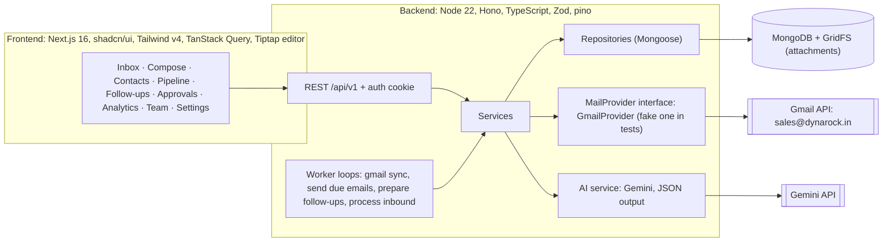

# Dynarock Sales: design

Status: **built** (phases 0–7, November 2026). See the README for what each phase delivered and docs/deployment.md for going live.

Dynarock Sales is the internal tool the Dynarock sales team uses to email colleges and universities about the Dynarock campus platform from the shared `sales@dynarock.in` mailbox. It records every email sent and received, sends follow-ups automatically when a client goes quiet, uses Gemini to write and answer emails, and shows the team's growth.

---

## 1. Decisions so far

| Topic | Decision |
| --- | --- |
| Mailbox | One shared mailbox, `sales@dynarock.in`, on **Google Workspace**, connected through the **Gmail API** |
| Visibility | Everyone on the team sees every contact and conversation. We still record **who sent each email**, for analytics |
| Roles | `admin` (manages users, mailbox, settings, automation) and `sales_rep` (all sales work) |
| Follow-ups | Planned follow-ups **send automatically** (at most 3, and they stop the moment the client replies). Each one is visible and editable before it goes out |
| AI replies | AI answers to real client replies **wait for a person to approve them** |
| AI model | **Gemini** (`@google/genai`), as today |
| Database | **MongoDB** through **Mongoose** (Prisma and PostgreSQL are removed) |
| Starting data | Empty: no contact import, no mailbox history backfill |
| Old code | Tag the current commit `v1-admission-detective`, then remove the NIAT code from `main` |
| Look | Matches dynarock.in: black and white with grey (zinc) tones, light and dark mode |

## 2. What Dynarock sells (what the AI works from)

From dynarock.in: *"The AI-Powered Campus Operating System"*, one platform that replaces a college's separate ERP, LMS and campus tools.

- **Modules:** admissions, academic structure and student records, attendance (timetable-linked for students, geofenced and biometric for staff), fees and student ledger, exams and result cards, timetable engine, placements cell, leave management, inventory and procurement, library, document requests, calendar and notifications, messaging and projects
- **AI features:** AI quiz generator, AI performance insights, AI course feedback forms
- **Trust points:** role-based access, full audit log, migration from legacy software
- **Offer:** free plan, no credit card required, "Schedule a demo"

**Who we email:** principals, directors, deans, registrars, IT heads, trustees and management at engineering colleges, universities, degree colleges, schools and institutes.

**Main goal of each email:** book a demo.

These facts are stored in the `products` collection, which the admin can edit. The AI may only use facts that appear there. A number, price or link in an AI draft that doesn't come from it is flagged for the salesperson, the same way the current `draft-checks.ts` works.

---

## 3. Architecture



**What we keep from the current code:** the Hono layering (routes → controllers → services → repositories), the composition root `container.ts`, Zod validation, the error format, pino logging, rate limits, the Gemini client, the draft checks for facts and links, the shadcn components and the chart wrapper.

**No job library.** The `scheduled_emails` and `sequence_enrollments` collections are the job queue. A worker loop runs every minute and claims due items one at a time with `findOneAndUpdate`, so an email can never be sent twice, even when two server copies run. A `locks` collection makes sure only one server copy syncs Gmail at a time.

### Gmail integration

- **Setup (once, by the Workspace admin):** create a Google Cloud project, enable the Gmail API, set the OAuth consent screen to **Internal** (only `@dynarock.in` accounts can use it, and Google doesn't need to review it), and create an OAuth client. Then the admin opens *Settings → Mailbox → Connect* in the app and signs in as `sales@dynarock.in`.
- **Permissions requested:** `gmail.modify` (read, send, mark as read) plus `openid email`.
- **Token storage:** the refresh token is stored **encrypted (AES-256-GCM)** using the `ENCRYPTION_KEY` setting.
- **Sending:** `users.messages.send` with a full email message. Replies pass the conversation's `threadId` plus `In-Reply-To` and `References` headers, so the conversation stays together in both Gmail and the app.
- **Receiving:** we save Gmail's `historyId` at connect. Every 60 seconds the app asks Gmail what changed since then (`users.history.list`) and fetches each new message. If Gmail says that position is too old, we fall back to `messages.list` for the last 7 days. Gmail's instant push notifications (Pub/Sub) can replace the 60-second check once the app is deployed on a public URL.
- **Emails sent straight from Gmail** (outside the app) are synced too, as outbound messages with `origin: gmail_external`.
- **Limits:** Workspace allows about 2,000 emails a day per mailbox. The app adds its own daily cap (default 300) and a send window (Mon–Sat, 9:00–18:00 IST).
- **Deliverability:** the admin should check that SPF, DKIM and DMARC are set up for `dynarock.in` in Workspace. Every automated email gets an unsubscribe link and a `List-Unsubscribe` header.

### AI (Gemini)

Every AI call asks for JSON in a fixed format (Gemini's `responseSchema`), and the server checks it with Zod.

| Feature | Trigger | Output | Sent automatically? |
| --- | --- | --- | --- |
| **AI Write** (compose) | Salesperson types an instruction in Compose | subject + body | No. It goes into the editor to edit |
| **Rewrite** | Improve / Shorten / More formal / Friendlier / Add demo call-to-action | new body | No |
| **Classify inbound** | Each new client email | intent, sentiment, one-line summary, suggested stage, details (meeting time, return date) | Not an email. It updates labels and stages |
| **Suggested reply** | New client email that needs an answer | reply draft + reason | **No: it waits in Approvals** |
| **Follow-up draft** | Previous step sent and no reply yet | follow-up body | **Yes, at the scheduled time.** It's visible and editable until then |
| **Thread summary** | Conversation opened or changed | 2–3 line summary | Not an email |

**Intent labels:** `interested`, `demo_request`, `question`, `pricing`, `objection`, `not_now`, `not_interested`, `out_of_office`, `unsubscribe`, `bounce`, `other`.

**Automatic actions:**
- `unsubscribe` marks the contact unsubscribed and stops all automation for them.
- `bounce` marks the contact bounced.
- `out_of_office` moves the next follow-up to after their return date.
- `demo_request` suggests moving the contact to "Demo scheduled". A person confirms the stage change.

**Guardrails:**
- Client emails are passed to the AI as data and never treated as instructions.
- The AI has no ability to send anything itself.
- Facts and links are checked against `products`.
- Follow-ups never go to contacts who are unsubscribed, bounced or marked do-not-contact.
- An admin switch, **Pause all automation**, stops every automatic send at once.

### Security

- Passwords are hashed with argon2id (`@node-rs/argon2`). Sessions are stored in MongoDB and set as an httpOnly, SameSite=Lax cookie, so an admin can revoke them.
- Users are created by invitation: the admin enters an email address, the app makes a one-time link valid for 7 days, and the new user sets their own password.
- **Client email HTML is cleaned (DOMPurify) and shown in a sandboxed iframe**, so a malicious email can't run code in the app.
- Every action goes into `activities`, which is both the audit log and each contact's timeline.

---

## 4. MongoDB collections (Mongoose)

All documents have `createdAt` / `updatedAt` (Mongoose `timestamps`). `ObjectId` references point to the collection in brackets. Email addresses are stored lowercase.

### Team and access

```ts
users {
  name: string
  email: string                          // unique
  passwordHash: string | null            // null until the invite is accepted
  role: "admin" | "sales_rep"
  status: "invited" | "active" | "disabled"
  signatureHtml: string                  // added to the bottom of their emails
  invitedBy: ObjectId<users> | null
  lastLoginAt: Date | null
}
// index: { email: 1 } unique

sessions {
  userId: ObjectId<users>
  tokenHash: string                      // sha256 of the cookie value; unique
  userAgent: string
  ip: string
  expiresAt: Date                        // TTL index removes expired sessions
}

invites {
  email: string
  role: "admin" | "sales_rep"
  tokenHash: string                      // unique
  invitedBy: ObjectId<users>
  expiresAt: Date                        // TTL index
  acceptedAt: Date | null
}
```

### Mailbox and settings

```ts
mailboxes {                              // one document today (sales@dynarock.in)
  email: string                          // unique
  provider: "gmail"
  status: "connected" | "error" | "disconnected"
  auth: { refreshTokenEnc: string; accessTokenEnc: string; expiresAt: Date; scopes: string[] }
  historyId: string | null               // Gmail sync position
  lastSyncAt: Date | null
  lastError: string | null
  connectedBy: ObjectId<users>
}

settings {                               // single document, _id: "global"
  automationPaused: boolean
  dailySendCap: number                   // default 300
  sendWindow: { days: number[]; startHour: number; endHour: number; timezone: string }  // [1..6], 9, 18, "Asia/Kolkata"
  defaultSequenceId: ObjectId<sequences> | null
  openTracking: boolean                  // default false (Apple/Gmail make opens unreliable)
  unsubscribeFooterHtml: string
  companySignatureHtml: string
}

locks { _id: string; owner: string; expiresAt: Date }   // e.g. _id "gmail-sync"
```

### Clients

```ts
organizations {
  name: string                           // "XYZ Institute of Technology"
  type: "university" | "engineering_college" | "degree_college" | "school" | "institute" | "other"
  domain: string | null                  // "xyz.edu.in": new contacts with this email domain are linked automatically
  website: string
  city: string; state: string; country: string   // country default "India"
  studentCount: number | null
  currentSystems: string                 // what they use today (Tally, Excel, other ERP)
  notes: string
  tags: string[]
  createdBy: ObjectId<users>
}
// indexes: { domain: 1 } unique sparse, { name: "text" }

contacts {
  email: string                          // unique
  name: string
  role: "principal" | "director" | "dean" | "registrar" | "it_head" | "trustee"
      | "faculty" | "admin_staff" | "other"
  designation: string                    // free text, e.g. "Vice Principal (Academics)"
  phone: string
  organizationId: ObjectId<organizations> | null
  stage: "new" | "contacted" | "replied" | "demo_scheduled" | "demo_done"
       | "proposal" | "negotiation" | "won" | "lost"
  lostReason: string
  ownerId: ObjectId<users> | null        // who looks after them (everyone can still see them)
  status: "active" | "unsubscribed" | "bounced" | "do_not_contact"
  source: "compose" | "manual" | "inbound" | "import"
  tags: string[]
  notes: string
  lastContactedAt: Date | null
  lastRepliedAt: Date | null
  createdBy: ObjectId<users> | null      // null when created by an inbound email
}
// indexes: { email: 1 } unique, { stage: 1 }, { organizationId: 1 }, { lastContactedAt: -1 }, text on name + email
```

Contacts are created from Compose automatically. Sending to an address that isn't in the system creates the contact, and links it to an organization when the email domain matches one.

### Email

```ts
threads {                                // one conversation, mirrors one Gmail thread
  mailboxId: ObjectId<mailboxes>
  gmailThreadId: string
  subject: string
  contactIds: ObjectId<contacts>[]
  organizationId: ObjectId<organizations> | null
  participants: { email: string; name: string }[]
  messageCount: number
  lastMessageAt: Date
  lastInboundAt: Date | null
  lastOutboundAt: Date | null
  state: "needs_reply"                   // client wrote last; we owe an answer
       | "awaiting_reply"                // we wrote last; waiting for the client
       | "closed"
  unread: boolean
  latestIntent: IntentLabel | null
  aiSummary: string
  startedBy: ObjectId<users> | null
  activeEnrollmentId: ObjectId<sequence_enrollments> | null
}
// indexes: { mailboxId: 1, gmailThreadId: 1 } unique, { lastMessageAt: -1 }, { state: 1, lastMessageAt: -1 }, { contactIds: 1 }

messages {
  threadId: ObjectId<threads>
  mailboxId: ObjectId<mailboxes>
  gmailMessageId: string                 // unique
  rfcMessageId: string                   // the Message-ID header
  inReplyTo: string | null
  references: string[]
  direction: "outbound" | "inbound"
  from: { email: string; name: string }
  to: { email: string; name: string }[]
  cc: { email: string; name: string }[]
  bcc: { email: string; name: string }[]
  subject: string
  html: string                           // cleaned before display
  text: string
  snippet: string
  attachments: { filename: string; mimeType: string; size: number; gmailAttachmentId?: string; fileId?: ObjectId }[]
  sentAt: Date
  sentByUserId: ObjectId<users> | null   // null for inbound, Gmail-direct sends and automatic follow-ups
  origin: "app_compose" | "app_reply" | "app_followup" | "app_ai_reply" | "gmail_external" | "inbound"
  ai: { generated: boolean; editedByHuman: boolean; suggestionId?: ObjectId } 
  followUpStep: number | null            // 1, 2, 3 for automatic follow-ups
  classification: {                      // inbound only
    intent: IntentLabel; confidence: number; sentiment: "positive" | "neutral" | "negative"
    summary: string; extracted: { meetingAt?: Date; returnDate?: Date }
  } | null
  isAutoReply: boolean
  isBounce: boolean
  tracking: { openCount: number; firstOpenedAt: Date | null } | null
}
// indexes: { gmailMessageId: 1 } unique, { threadId: 1, sentAt: 1 }, { direction: 1, sentAt: -1 }, { sentByUserId: 1, sentAt: -1 }

drafts {                                 // Compose autosave, like Gmail drafts
  userId: ObjectId<users>
  mode: "new" | "reply" | "reply_all" | "forward"
  threadId: ObjectId<threads> | null
  replyToMessageId: ObjectId<messages> | null
  to: string[]; cc: string[]; bcc: string[]
  subject: string
  html: string
  attachmentFileIds: ObjectId[]          // GridFS
  aiGenerated: boolean
}

scheduled_emails {                       // "send later" and automatic follow-ups; also the send queue
  kind: "send_later" | "follow_up"
  threadId: ObjectId<threads> | null     // null for a new email scheduled from Compose
  contactId: ObjectId<contacts>
  to: string[]; cc: string[]; bcc: string[]
  subject: string
  html: string
  attachmentFileIds: ObjectId[]
  sendAt: Date
  status: "scheduled" | "sending" | "sent" | "cancelled" | "failed" | "skipped"
  statusReason: string                   // "client replied", "unsubscribed", "outside cap", the error text
  enrollmentId: ObjectId<sequence_enrollments> | null
  step: number | null
  aiGenerated: boolean
  createdBy: ObjectId<users> | null      // null = created by the system
  lastEditedBy: ObjectId<users> | null
  sentMessageId: ObjectId<messages> | null
  attempts: number
}
// index: { status: 1, sendAt: 1 }
```

### Follow-up automation

```ts
sequences {                              // follow-up plan, e.g. "Default: 3 follow-ups"
  name: string
  description: string
  active: boolean
  steps: {
    order: number                        // 1, 2, 3
    delayDays: number                    // days after the previous email with no reply
    mode: "ai" | "template"
    instruction: string                  // for AI: "short bump, mention free plan"
    templateId: ObjectId<templates> | null
  }[]
  createdBy: ObjectId<users>
}

sequence_enrollments {                   // one thread following one sequence
  sequenceId: ObjectId<sequences>
  threadId: ObjectId<threads>
  contactId: ObjectId<contacts>
  status: "active" | "paused" | "completed" | "stopped"
  stopReason: "replied" | "unsubscribed" | "bounced" | "manual" | null
  currentStep: number                    // last step sent (0 = only the first email)
  nextStepAt: Date | null
  enrolledBy: ObjectId<users>
}
// partial unique index: one "active" enrollment per thread
```

**How a follow-up runs:**

1. The salesperson sends an email with *Follow up automatically* ticked. The enrollment starts.
2. As soon as an email in the plan is sent, the system creates the next follow-up in `scheduled_emails`. Its sending time is the previous email's time plus `delayDays`, moved into the send window. The AI writes the body right away.
3. The follow-up shows in the conversation and on the Follow-ups page as **Scheduled**, where anyone can edit it, send it now, or cancel it.
4. When a client reply arrives, every scheduled follow-up in that conversation is cancelled and the enrollment stops with `stopReason: "replied"`.
5. Just before sending, the worker checks again: contact still active, automation not paused, daily cap not reached, no reply in the meantime.

### AI

```ts
ai_suggestions {                         // AI reply drafts waiting for approval
  type: "reply"
  threadId: ObjectId<threads>
  contactId: ObjectId<contacts>
  forMessageId: ObjectId<messages>       // the client email it answers
  subject: string
  html: string
  rationale: string                      // why the AI answered this way
  warnings: string[]                     // figures or links not found in products
  status: "pending" | "sent" | "rejected" | "superseded"  // superseded: a newer client email arrived
  reviewedBy: ObjectId<users> | null
  reviewedAt: Date | null
  editedBeforeSend: boolean
  sentMessageId: ObjectId<messages> | null
}
// index: { status: 1, createdAt: -1 }

ai_runs {                                // usage and cost tracking
  kind: "compose" | "rewrite" | "classify" | "reply" | "follow_up" | "summary"
  userId: ObjectId<users> | null
  model: string
  inputTokens: number; outputTokens: number
  durationMs: number
  ok: boolean
  error: string | null
}
```

### Content

```ts
products {                               // knowledge base the AI must stick to
  name: string                           // "Fees & Student Ledger"
  category: "module" | "ai_feature" | "offer" | "company" | "faq" | "case_study"
  summary: string
  details: string
  pitchByRole: { [role: string]: string }   // { it_head: "RBAC, audit log, migration handled", principal: "..." }
  url: string
  active: boolean
  updatedBy: ObjectId<users>
}

templates {
  name: string
  category: "intro" | "follow_up" | "demo" | "proposal" | "other"
  subject: string
  html: string                           // supports {{contact.firstName}}, {{organization.name}}, {{sender.name}}
  createdBy: ObjectId<users>
  usageCount: number
}
```

### Activity (audit log and timeline)

```ts
activities {
  actor: { type: "user" | "system" | "ai"; userId: ObjectId<users> | null }
  action: string                         // "email.sent", "email.received", "contact.created", "contact.stage_changed",
                                         // "followup.scheduled", "followup.cancelled", "suggestion.sent", "user.invited", ...
  contactId: ObjectId<contacts> | null
  threadId: ObjectId<threads> | null
  entity: { type: string; id: ObjectId } | null
  meta: object                           // e.g. { from: "replied", to: "demo_scheduled" }
}
// indexes: { contactId: 1, createdAt: -1 }, { createdAt: -1 }
```

Attachments are stored in **GridFS** (inside MongoDB, so no separate file storage is needed). Attachments on client emails are not copied; they're downloaded from Gmail when someone opens them.

---

## 5. API (`/api/v1`)

All routes need a signed-in user except the `auth` and public routes. **(A)** means admin only.

| Area | Method and path | Purpose |
| --- | --- | --- |
| Auth | `POST /auth/login` · `POST /auth/logout` · `GET /auth/me` | Session cookie |
| | `POST /auth/accept-invite` · `POST /auth/change-password` | |
| Team (A) | `GET /users` · `POST /users/invite` · `PATCH /users/:id` · `POST /users/:id/resend-invite` | Role, disable (a user is never deleted, so their history stays) |
| Mailbox (A) | `GET /mailbox` · `GET /mailbox/connect` · `GET /mailbox/oauth/callback` · `POST /mailbox/sync` · `POST /mailbox/disconnect` | Google OAuth and the "Sync now" button |
| Settings (A) | `GET /settings` · `PATCH /settings` | Automation pause, cap, send window, footer |
| Threads | `GET /threads?state=&intent=&sentBy=&contactId=&q=&cursor=` | Inbox list |
| | `GET /threads/:id` | Messages, scheduled follow-ups, pending suggestion, enrollment |
| | `PATCH /threads/:id` | Mark read or unread, close or reopen |
| Send | `POST /emails/send` | New email: `{to, cc, bcc, subject, html, attachmentFileIds, followUp: {sequenceId} \| null, sendAt?}` |
| | `POST /threads/:id/reply` | `{mode: reply \| reply_all \| forward, to?, cc?, bcc?, subject?, html, attachmentFileIds}` |
| Drafts | `GET /drafts` · `POST /drafts` · `PATCH /drafts/:id` · `DELETE /drafts/:id` | Compose autosave |
| Files | `POST /files` (multipart) · `GET /files/:id` · `GET /messages/:id/attachments/:attId` | Uploads and downloads |
| Scheduled | `GET /scheduled-emails?status=&kind=` · `PATCH /scheduled-emails/:id` · `POST /scheduled-emails/:id/send-now` · `POST /scheduled-emails/:id/cancel` | Edit follow-ups before they go |
| Sequences | `GET/POST /sequences` · `PATCH/DELETE /sequences/:id` (A) | Follow-up plans |
| | `POST /threads/:id/enroll` · `POST /enrollments/:id/pause \| resume \| stop` | |
| AI | `POST /ai/compose` `{instruction, to?, contactId?, threadId?, tone?}` → `{subject, html, warnings}` | AI Write |
| | `POST /ai/rewrite` `{html, action}` → `{html, warnings}` | Improve, Shorten and the other rewrite buttons |
| | `POST /threads/:id/ai/suggest-reply` | Ask the AI for a reply now |
| | `GET /ai/suggestions?status=pending` · `POST /ai/suggestions/:id/send` `{subject, html}` · `POST /ai/suggestions/:id/reject` | Approvals |
| Contacts | `GET /contacts?q=&stage=&organizationId=&ownerId=` · `POST /contacts` · `GET /contacts/:id` · `PATCH /contacts/:id` | `GET :id` includes the timeline |
| Organizations | `GET/POST /organizations` · `GET/PATCH /organizations/:id` | |
| Pipeline | `GET /pipeline` · `PATCH /contacts/:id/stage` `{stage, lostReason?}` | Kanban board |
| Templates | `GET/POST /templates` · `PATCH/DELETE /templates/:id` | |
| Knowledge (A) | `GET/POST /products` · `PATCH/DELETE /products/:id` | What the AI may say |
| Analytics | `GET /analytics/overview?from=&to=` | KPI cards plus the change against the previous period |
| | `GET /analytics/timeseries?metric=&interval=day\|week\|month&from=&to=` | Growth charts |
| | `GET /analytics/team` · `/analytics/funnel` · `/analytics/follow-ups` · `/analytics/ai` | |
| Activity | `GET /activities?contactId=&threadId=&cursor=` | |
| Public | `GET /u/:token` · `POST /u/:token` | Unsubscribe page (token is HMAC-signed, no login needed) |
| | `GET /t/:token.gif` | Open pixel, only when open tracking is turned on |
| System | `GET /healthz` · `GET /readyz` | |

---

## 6. Background work (worker loops inside the API process)

| Loop | Every | What it does |
| --- | --- | --- |
| `gmail-sync` | 60 s (holds the `locks` entry) | Fetch new messages since `historyId` and save threads and messages. Each new inbound message goes to `process-inbound` |
| `process-inbound` | on each new inbound message | Spot bounces and auto-replies, classify with Gemini, update the thread state and the contact's stage and last reply, stop sequences, cancel scheduled follow-ups, create the reply suggestion |
| `send-due` | 60 s | Claim due `scheduled_emails` (`scheduled → sending`), re-check the rules, send through Gmail, save the message, schedule the next follow-up step |
| `prepare-follow-ups` | 15 min | Safety sweep: active enrollments whose next step was never scheduled get it created now |

---

## 7. Screens

| Page | What's on it |
| --- | --- |
| `/login`, `/accept-invite` | Sign in; set a password from an invite link |
| **Global Compose** | A floating window at the bottom right, available on every page. It can be minimised or made full screen, and several can be open at once. Contents: To/Cc/Bcc with contact search (a new address is fine), subject, Tiptap editor, **✨ AI Write** box, rewrite buttons, templates, attachments, signature, a *Follow up automatically* option with the plan picker, and *Send* or *Schedule send*. Drafts save automatically |
| `/inbox` | Three panes: the conversation list (tabs: **Needs reply**, **Awaiting reply**, **Scheduled**, **Sent**, **All**; filters for sender, intent and stage; search) · the conversation · the contact side panel (stage, organization, timeline). In the conversation: Reply, Reply all and Forward open inline, the AI-suggested reply sits ready to edit, and planned follow-ups show as dashed "scheduled" cards with Edit, Send now and Cancel |
| `/approvals` | AI reply drafts waiting for review, with the client's email beside each draft and any warnings shown |
| `/follow-ups` | Everything scheduled to send (filter: today, this week); follow-up plans (sequences) and their results |
| `/contacts`, `/contacts/:id` | Table with search and filters; detail page with every email, stage history and notes |
| `/organizations`, `/organizations/:id` | Institutions, with their people and conversations |
| `/pipeline` | Kanban board by stage, with drag to move |
| `/dashboard` | KPI cards: emails sent, reply rate, demos booked, won, average reply time, each with the change against last period. Charts: emails sent and replies per week, pipeline funnel, follow-up step results, team leaderboard |
| `/templates`, `/knowledge` | Saved emails; Dynarock product facts for the AI |
| `/team` (A) | Users, invite, change role, disable |
| `/settings` | Mailbox connection and sync status; automation (pause, cap, send window); my signature; unsubscribe footer |

### Analytics definitions

| Metric | Definition |
| --- | --- |
| Emails sent | Outbound messages in the period, split into manual, AI-assisted and automatic follow-up |
| Reply rate | Conversations we started in the period that got at least one real reply (auto-replies and bounces don't count) |
| Average client reply time | Time from our email to the client's first reply |
| Our response time | Time from a client email to our answer (the "needs reply" wait) |
| Demos booked | Contacts that moved to `demo_scheduled` in the period |
| Follow-up effectiveness | Reply rate after step 1, step 2 and step 3 |
| AI acceptance | Share of AI suggestions sent unchanged, sent after edits, or rejected |
| Team | Per salesperson: emails sent, replies received, demos, won |

---

## 8. Configuration (`backend/.env`)

| Variable | Purpose |
| --- | --- |
| `MONGODB_URI` | e.g. `mongodb://localhost:27017/dynarock_sales` or a MongoDB Atlas URI |
| `ENCRYPTION_KEY` | 32-byte base64 key for the Gmail tokens |
| `SESSION_TTL_DAYS` | Default 14 |
| `GOOGLE_CLIENT_ID` / `GOOGLE_CLIENT_SECRET` / `GOOGLE_REDIRECT_URI` | Gmail OAuth client |
| `GEMINI_API_KEY` / `GEMINI_MODEL` | As today |
| `PUBLIC_BASE_URL` | Base for unsubscribe and tracking links |
| `FRONTEND_ORIGIN` | CORS |
| `BOOTSTRAP_ADMIN_EMAIL` / `BOOTSTRAP_ADMIN_PASSWORD` | Creates the first admin when there are no users yet |
| `GMAIL_SYNC_INTERVAL_SECONDS` | Default 60 |

---

## 9. Build plan

| Phase | Delivers |
| --- | --- |
| 0. Clean-up | Tag `v1-admission-detective`; remove Prisma, NIAT modules, landing page and seed data; add Mongoose, config and the test setup (`mongodb-memory-server`) |
| 1. Accounts | Users, sessions, invites, roles, login screens, Team page, app shell with the Dynarock look |
| 2. Mailbox | Gmail OAuth connect, sync loop, threads and messages, sending new emails and replies, drafts, attachments. **Inbox and Global Compose UI** |
| 3. Contacts | Contacts, organizations, pipeline kanban, activity timeline |
| 4. AI | Product knowledge base (seeded from dynarock.in), AI Write and rewrite in Compose, inbound classification, suggested replies and Approvals |
| 5. Automation | Sequences, enrollments, scheduled emails, the send-due loop, unsubscribe page, Follow-ups page |
| 6. Analytics | Dashboard and analytics endpoints |
| 7. Polish | Empty, loading and error states, mobile layout, README, Docker, CI |

Tests use a **fake MailProvider** and a **scripted Gemini**, the same approach the current test suite uses, so the whole flow (send → reply arrives → follow-ups cancelled → suggestion created) can be tested without a real mailbox.

## 10. Not in the first version

WhatsApp, calendar booking links, CSV import (no existing data), separate per-salesperson mailboxes, deals with amounts, tasks and reminders, Gmail push notifications (polling first).
